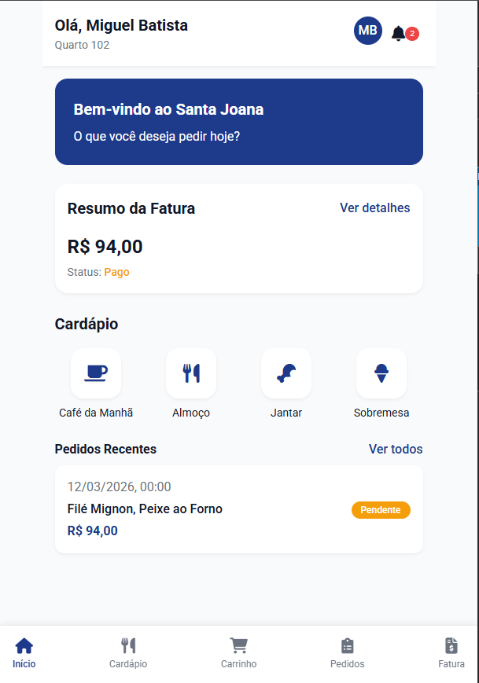
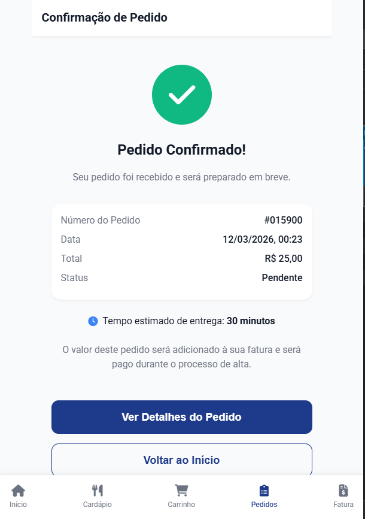
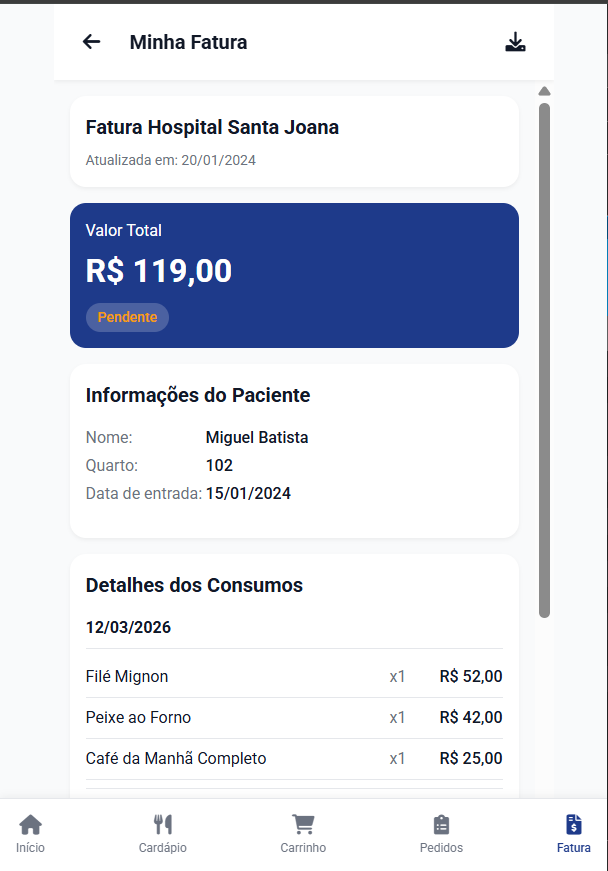
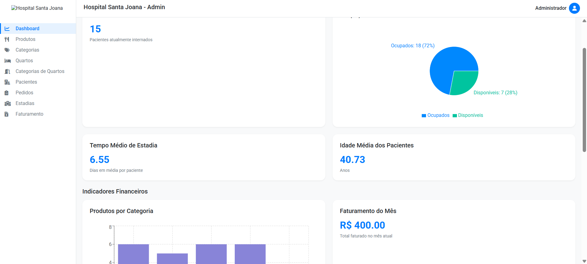
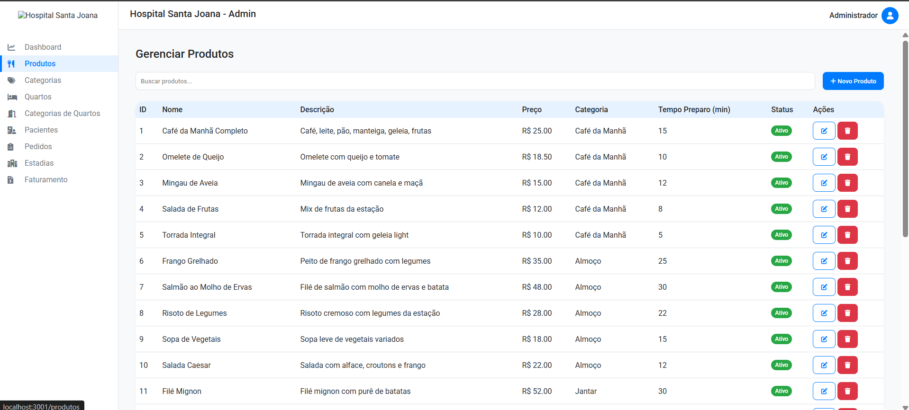
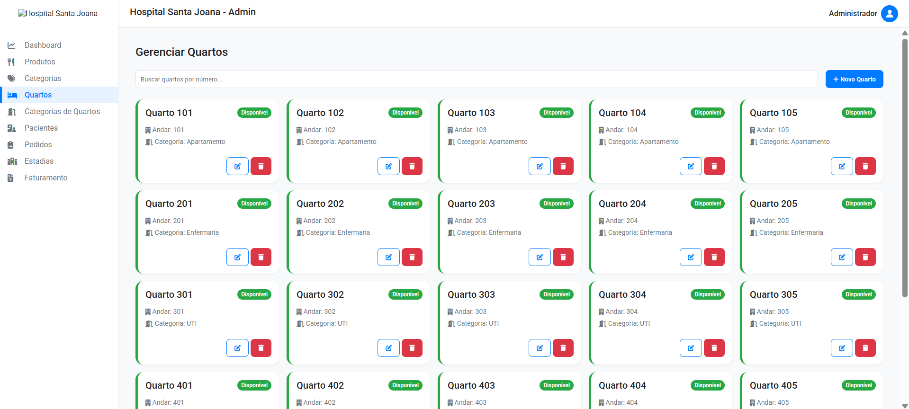

# Hospital Santa Joana - Hospital Management System

<p align="center">
  
</p>

<p align="center">
  
  
  
  
  
  
</p>

## 🎬 Media Gallery

### Screenshots









### Videos

- [Client flow video](media/cliente%20flow.mp4)
- [Admin flow video](media/admin%20flow.mp4)

Welcome to the Hospital Santa Joana hospital management system repository! This project offers a comprehensive solution for patient management, meal orders, invoices, rooms, and much more, with a modern web frontend and robust backend.

---

## ✨ Overview

- **Frontend:** Responsive SPA for patients, with meal orders, history, invoices, and profile.
- **Backend:** RESTful API in Java Spring Boot, MySQL persistence.
- **Admin:** Administrative panel (React) for managing products, categories, rooms, patients, etc.
- **Infrastructure:** Docker Compose for container orchestration.

---

## 🚀 Quick Start

### 1. Clone the repository
```bash
git clone https://github.com/MigueldsBatista/projeto_database.git
cd projeto_database
```

### 2. Start the backend (API + database)
```bash
cd santajoana
# Edit compose.yaml if you want to customize ports
sudo docker compose up -d
```
Wait until the backend is available at http://localhost:8080

### 3. Populate the database
```bash
mysql -h 127.0.0.1 -P 3307 -u admin -p < populate_database.sql
```
Or use a graphical client (DBeaver, MySQL Workbench, etc) and run the `populate_database.sql` script.

### 4. Start the frontend
- **Via Live Server (VS Code):**
  1. Open the `client/` folder in VS Code
  2. Right-click on `index.html` > "Open with Live Server"
  3. Access `http://127.0.0.1:5500/index.html`
- **Via Docker/Nginx:**
  1. Adjust `nginx.conf` if necessary
  2. Run the container according to Dockerfile instructions

---

## ⚙️ Detailed Configuration

### Prerequisites
- Docker and Docker Compose
- MySQL Client (to populate database)
- Visual Studio Code + Live Server (optional, for frontend)

### Backend
- The backend starts via Docker Compose and exposes the API at `http://localhost:8080`.
- The MySQL database runs on `localhost:3307` (see compose.yaml).
- The `populate_database.sql` script inserts essential data (categories, products, patients, rooms, etc).

### Frontend
- The frontend expects the API at `http://localhost:8080` (adjust in `js/utils.js` if necessary).
- Use Live Server or a static web server to run the interface.

### Admin
- The admin panel runs in React (folder `admin/`).
- Install dependencies and run with:
```bash
cd admin
npm install
npm start
```

<p align="center">
  
</p>

---

## 🧩 Features
- Patient registration and login
- Meal ordering by category
- Shopping cart
- Order history and details
- Invoice viewing and payment status
- Patient profile
- Admin panel for managing products, categories, rooms, patients, invoices, etc

